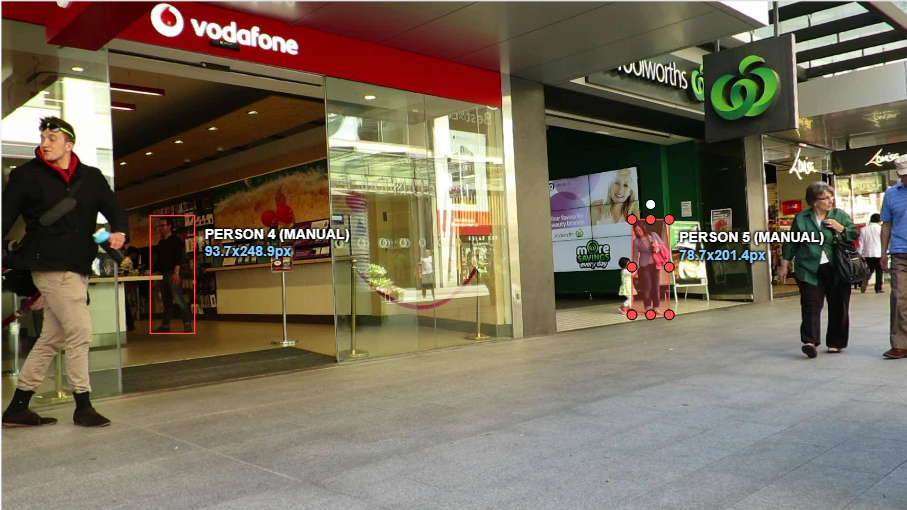
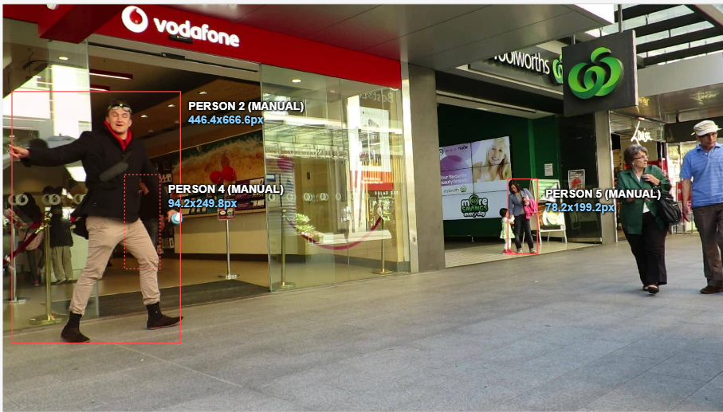
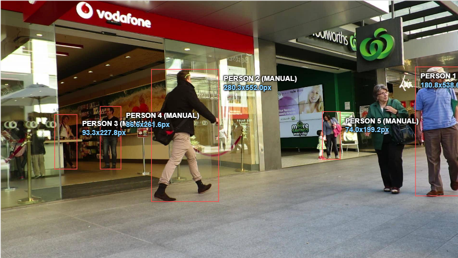

# Báo cáo cá nhân — DuongTriDung-2A202603341

Đổi tên file theo quy tắc `MSSV_HoTen.md`. Ví dụ: `20241234_NguyenVanAn.md`.

Đoạn video: MOT17-09, 150 frame (frame 1–150), nguồn MOTChallenge, giấy phép CC BY-NC-SA 3.0.

## 0. Thông tin học viên

- Họ tên: Dương Trí Dũng
- MSSV: 2A202603341
- Mã đề (A/B/C): đề C
- Email: [26ai.dungdt4@vinuni.edu.vn](mailto:26ai.dungdt4@vinuni.edu.vn)
- Link repository: https://github.com/hurtmyneck/K5-L2B-DAY05-DuongTriDung-2A202603341-MOTTracking
- Giờ bắt đầu:16h45
- Giờ kết thúc:19h25

## 1. Xem trước đoạn video (CP0)

Ghi **trước khi vẽ**, mỗi người một dòng.

| Mã  | Frame xuất hiện | Frame cuối thấy được | Rẽ / dừng / đổi tốc độ ở frame | Bị che ở frame | Ghi chú |
| --- | --------------- | -------------------- | ------------------------------ | -------------- | ------- |
| P1  | 0               | 149                  | 0                              |                |         |
| P2  | 2               | 104                  | 0                              |                |         |
| P3  | 28              | 135                  | 0                              |                |         |
| P4  | 40              | 149                  | 0                              |                |         |
| P5  | 61              | 149                  | 0                              |                |         |

## 2. Keyframe và thời gian (CP1, CP4)

Số keyframe lấy từ kết quả `src/check_submission.py`.

| Mã       | Số keyframe | Keyframe ở frame                                                                                                                                                                     | Số frame có mặt | Keyframe / 100 frame | Thời gian (phút) | Chỗ khó |
| -------- | ----------- | ------------------------------------------------------------------------------------------------------------------------------------------------------------------------------------ | --------------- | -------------------- | ---------------- | ------- |
| P1       | 15          | 40, 50, 60, 70, 80, 90, 100, 105, 110, 117, 120, 122, 130, 140, 149                                                                                                                  | 149             | 13.6                 |                  |         |
| P2       | 41          | 28, 36, 38, 39, 40, 45, 50, 55, 57, 58, 60, 65, 70, 75, 80, 85, 90, 93, 94, 95, 96, 97, 99, 100, 105, 106, 107, 110, 112, 113, 114, 115, 117, 118, 127, 128, 129, 131, 132, 133, 135 | 102             | 41                   |                  |         |
| P3       | 33          | 61, 62, 63, 64, 65, 66, 67, 70, 71, 72, 73, 74, 75, 76, 77, 78, 79, 80, 85, 86, 91, 96, 100, 105, 110, 115, 120, 125, 130, 135, 140, 145, 149                                        | 107             | 37.1                 |                  |         |
| P4       | 32          | 0, 10, 15, 20, 29, 30, 46, 49, 50, 51, 52, 54, 55, 60, 61, 65, 70, 75, 80, 85, 90, 95, 100, 105, 110, 115, 120, 125, 130, 140, 145, 149                                              | 109             | 22.4                 |                  |         |
| P5       | 12          | 2, 7, 12, 17, 22, 27, 32, 37, 42, 47, 82, 89                                                                                                                                         | 88              | 11.7                 |                  |         |
| **Tổng** | 133         |                                                                                                                                                                                      | 545             |                      |                  |         |
|          |             |                                                                                                                                                                                      |                 |                      |                  |         |

Keyframe / 100 frame của cả bài = tổng keyframe ÷ tổng số frame có mặt × 100 = 24.4

Bạn đặt keyframe nhiều nhất ở người nào? Vì sao (người đó rẽ, dừng, lại gần camera hay bị che)?

Keyframe nhiều nhất ở P3 do người này bị che

## 3. Đoạn bị che (CP2)

Người bị che: `P_1`

| Mốc                                      | Frame |
| ---------------------------------------- | ----: |
| Bắt đầu bị che một phần (bật `occluded`) |    29 |
| Mất hẳn (bật `outside`)                  |    39 |
| Hiện lại (tắt `outside`)                 |    45 |
| Thấy rõ trở lại (tắt `occluded`)         |    60 |

- Thời gian khuất hẳn: 6 frame = 0.1 giây.
- Quyết định: giữ cùng ID.
- Lý do (trả lời 3 câu: khuất bao lâu so với 60 frame, ngoại hình có khớp, chỗ hiện lại có đúng hướng và tốc độ):

Khuất 0.1 giây so với 60 frame. Ngoại hình khớp. Chỗ hiện lại đúng hướng và tốc độ

Ảnh chụp màn hình:





## 4. Tự review ID (CP3)

Lượt 1 theo người (đi ngược từ frame 149 về 0 trên CVAT), lượt 2 theo cảnh (nhảy 10 frame). Ít nhất 3 dòng; không có lỗi thì ghi một dòng "đã kiểm hai lượt, không lỗi".

Loại lỗi dùng đúng một trong 7 mã: `id_switch`, `fragmentation`, `lost`, `merge`, `false_track`, `drift`, `flag`.
Đã kiểm 2 lượt, không có lỗi
## 5. File xuất và kết quả tự kiểm (CP4)

| Kiểm tra                                                  | Kết quả |
| --------------------------------------------------------- | ------- |
| Tên file MOT 1.1                                          | đạt     |
| Tên file CVAT for video 1.1                               | đạt     |
| Số track ID khác nhau trong `gt/gt.txt` (phải là 5)       | đạt     |
| Frame `outside` không có dòng trong `gt.txt` (đúng / sai) | đúng    |
| Job đã completed trên CVAT máy cá nhân                    | đúng    |

Dán phần tóm tắt in ra từ `src/check_submission.py`:

```text
=== Tóm tắt ===
  Lỗi: 0   |   Cảnh báo: 0
  Đạt. Dán phần tóm tắt này vào báo cáo mục 5.
```

## 6. Ba câu kết

1. Nếu được gán lại, bạn sẽ đặt keyframe khác ở đâu? Vì sao?

   ...

2. Có chỗ nào bạn không chắc "cùng ID hay ID mới"? Bạn đã quyết định và ghi chú thế nào?

   ...

3. Một lỗi ID trong job của bạn (nếu không còn sót, chọn lỗi đã sửa) có thể làm xe tự lái dự đoán sai chuyển động của người đó như thế nào? Lỗi đó ảnh hưởng MOTA hay IDF1 nhiều hơn?

   ...

## Bonus (nếu làm)

### B1 — Hai người đi sát

...

### B2 — So cách đặt keyframe

| Cách đặt | Số keyframe | Frame trôi nhất | Ghi chú |
|---|---:|---:|---|
| Đều mỗi 30 frame | | | |
| Theo chỗ đổi hướng | | | |

...

### B3 — So với tracker có sẵn

| Frame | Mã người | Tracker làm gì | Nhãn của bạn | Giải thích (đoán rồi sửa / ghép IoU / box score thấp / ngoại hình) |
|---:|---|---|---|---|
| | | | | |
| | | | | |

## 7. Tài liệu tham khảo và công cụ AI đã dùng

Tài liệu tham khảo: hướng dẫn của btc
Công cụ AI đã dùng: không
